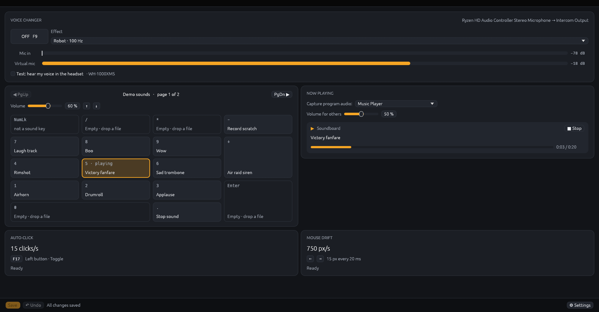
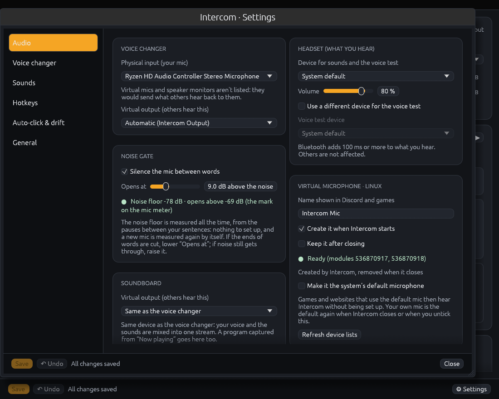
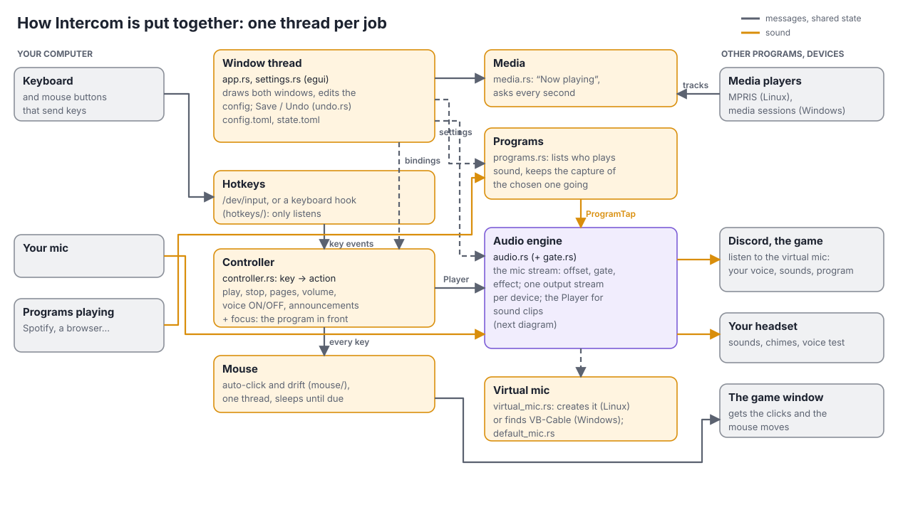
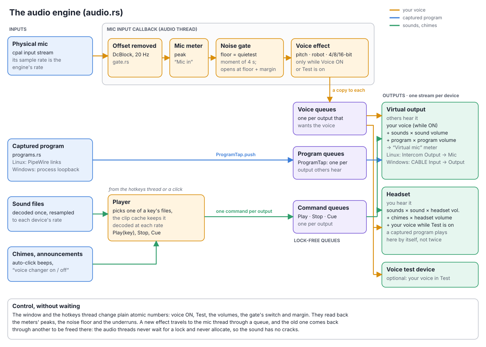
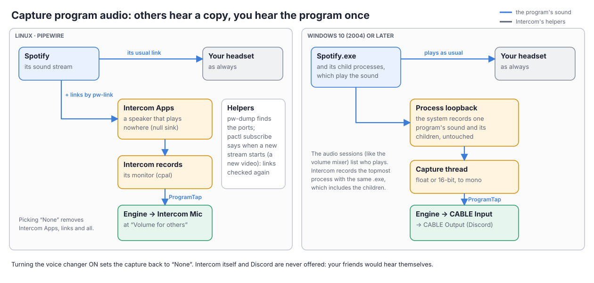

# Intercom

Intercom is one window that does what a gamer usually needs three programs for:

- **A soundboard on the numpad.** Each numpad key plays a sound file. Other players hear it in the game or in Discord, and you hear it in your headset. Page Up / Page Down switch between pages of sounds.
- **A live voice changer.** Your microphone goes through an effect (pitch, robot, or an 8-bit console voice) before others hear it. One key turns it on and off, and a short voice line in your headset tells you which.
- **Auto-click and mouse drift.** A key (or a mouse button that sends one) clicks for you at a steady rate. The arrow keys can slowly turn the mouse left or right.

It works on **Linux** and **Windows**. The voice effects come from the [voice-changer](../voice-changer) project next door, used as a library.

You don't need to know any Rust to use it. Part 1 gets it running, Part 2 explains how to use it, and Part 3 is a tour of the code.

---

## Part 1: Install

### 1.1 What you need

**Rust**, to build the program. On Linux, first install a C linker and the sound headers, then Rust:

```
# Debian, Ubuntu, Mint
sudo apt install build-essential pkg-config libasound2-dev pulseaudio-utils
# Fedora
sudo dnf install gcc pkgconf-pkg-config alsa-lib-devel pulseaudio-utils
# Arch
sudo pacman -S base-devel alsa-lib libpulse

curl --proto '=https' --tlsv1.2 -sSf https://sh.rustup.rs | sh
```

On Windows, install Rust from <https://rustup.rs> and accept the "Visual Studio Build Tools" it offers.

`pulseaudio-utils` (or `libpulse`) provides `pactl`, which Intercom uses to create its virtual microphone. It works with PipeWire too, which most desktops use today. Capturing a program's sound (2.2) needs PipeWire's `pw-link` and `pw-dump`, which come with it (Debian/Ubuntu: `pipewire-bin`).

### 1.2 Linux

From the `intercom` folder:

```
sh packaging/linux/install.sh
```

This builds Intercom and installs it for you only, with no `sudo`: the program goes in `~/.local/bin`, plus an "Intercom" entry with its icon in your app menu. `sh packaging/linux/uninstall.sh` removes it all and keeps your settings.

Two one-time permissions are needed. The install script tells you if one is missing.

- **Global hotkeys** read the keyboard directly, so they work whichever window is in front. Your user needs to be in the `input` group:
  ```
  sudo usermod -aG input $USER
  ```
  Then log out and back in.
- **Auto-click and drift** create a virtual mouse through `/dev/uinput`. If Steam is installed this already works. Otherwise Settings › Auto-click & drift shows the one-line fix.

### 1.3 Windows

1. Install **VB-Audio Virtual Cable** (<https://vb-audio.com/Cable/>, free) and restart. Windows can't create a virtual microphone by itself, so Intercom plays into "CABLE Input", and your game or Discord listens to "CABLE Output".
2. From the `intercom` folder, in PowerShell:
   ```
   powershell -ExecutionPolicy Bypass -File packaging\windows\package.ps1
   ```
   This builds Intercom and makes `dist\Intercom-windows.zip`. Unzip it anywhere and run `Intercom.exe`; there's nothing to install. To try it without packaging, `cargo run --release` works too.

If a game runs **as administrator**, Windows hides your keys from Intercom and blocks its clicks. Run Intercom as administrator too (Settings › General has a button, and an "always" option).

---

## Part 2: Use it

### 2.1 First start

- **Linux:** Intercom creates a virtual microphone called **"Intercom Mic"**, and removes it when it closes.
- **Windows:** Intercom finds VB-Cable.

In your game or in Discord, pick that microphone ("CABLE Output" on Windows). Others then hear your changed voice and your sounds, mixed together.

Your real microphone is the system's default mic at first, and your headset the default speaker. Change them in Settings › Audio. Only real microphones are listed there: a virtual mic or a speaker's "monitor" would send what others hear back to them.

To let games and websites that only use the default mic hear Intercom, tick **Make it the system's default microphone** in Settings › Audio. Your own mic is the default again when Intercom closes.

### 2.2 The main window



- **Voice changer:**
  - the ON/OFF button (or its key)
  - the effect
  - two meters: your mic, and what others hear. The mark on the mic's meter is where the noise gate opens.
  - "Test" plays your changed voice in your headset, so you can try effects without anyone hearing.
- **Sounds:**
  - **Assign a file:** drop it on a key, or click the key.
  - **Several files on one key:** one is picked at random each time.
  - **Volume:** each key has its own, and the slider (or ↑ / ↓) sets the volume for all sounds.
- **Now playing:** the sound playing on the soundboard, and what other programs play (Spotify, your browser, a video player...), each with its progress and its ⏮ ⏸ ⏭ buttons. It sits under the sounds, or beside them when the window is maximized or fullscreen (F11).
  - **Capture program audio:** pick a program, and others hear it through your virtual mic, at the "Volume for others". You keep hearing it as usual, once. It starts on "None", and turning the voice changer on sets it back to "None". Discord is never listed: your friends would hear themselves.
  - Windows needs Windows 10 version 2004 or later for this.
- **Auto-click and drift:** what they're set to, and whether they're running right now.
- **Reduce a block:** click its title (▾). It shrinks to one line that still shows the essentials: the ON/OFF button and the effect, the page and volume, what's playing, the clicks/s or the drift speed. Click again to open it. Intercom remembers which blocks are reduced.
- **Save / Undo** at the bottom:
  - Changes apply at once.
  - **Save** keeps them for next time.
  - **Undo** goes back one change at a time.

### 2.3 The keys (all can be changed in Settings › Hotkeys)

| Key | Does |
|---|---|
| Numpad 0-9, / * - + Enter | Play the current page's sound |
| Numpad . | Stop the sound |
| Page Up / Page Down | Previous / next page |
| ↑ / ↓ | Sound volume up / down |
| F9 | Voice changer on / off |
| ← / → | Mouse drift left / right (the same key again stops it) |
| F17 | Auto-click trigger (set a mouse button to send F17) |

Intercom only *listens* to keys: every key still reaches the game. So a frozen Intercom can never block your keyboard.

### 2.4 Settings



The other tabs: [Voice changer](readme/images/settings-voice.png) · [Sounds](readme/images/settings-sounds.png) · [Hotkeys](readme/images/settings-hotkeys.png) · [Auto-click & drift](readme/images/settings-input.png) · [General](readme/images/settings-general.png)

| Tab | What's there |
|---|---|
| Audio | Microphone, headset, virtual outputs, the headset volume, the **noise gate**, the virtual mic (and making it the default mic), **latency** (smaller audio blocks = less delay; raise it if you hear cracks), and tips for Discord's settings when Discord is installed |
| Voice changer | The effect and its options, turn ON at start, and the **spoken confirmation** (volume, your own sound files, "speak 'on' in the new voice") |
| Sounds | Pages and keys, and importing the old app's `AudioConfig.json` |
| Hotkeys | Every key, with a check that no key is used twice |
| Auto-click & drift | Rate, mode, mouse button, press length, the faster / slower / mode keys, start/stop sounds, drift speed, and **Import from Valkyrie** |
| General | **Only while a program is in front**, start at login, window options, colors, and the system-specific parts |

**Only while a program is in front:** with this on, Intercom ignores its keys unless that program (for example `SCPSL.exe`) has the focus. Leaving the program stops the clicking, the drift and the sound. The tab shows which program is in front, and offers the last one you used, so you don't have to guess its name.

- **Windows:** this sees every program.
- **Linux:** Wayland doesn't tell programs which window is in front. Intercom asks XWayland instead, which runs games (Proton games, and native ones like SCP:SL). A native Wayland window, such as your browser, counts as "not the game", which is what this option needs.

The settings live in `~/.config/intercom/config.toml` (Windows: `%APPDATA%\intercom\config.toml`). It's plain text, and you can edit it by hand.

### 2.5 Noise gate

The noise gate silences your mic between words, so others don't hear your fan or your keyboard. There's nothing to set up: it keeps measuring your mic's noise floor from the pauses between your sentences, and opens only for what is clearly louder. A new mic is measured again by itself. Settings › Audio shows the floor it measured. If the ends of your words are cut, lower "Opens at"; if noise still gets through, raise it.

Some mics also add a constant offset to their signal (the digital mics of AMD laptops on Linux do). It isn't sound, but it shows as a loud level on the meter even in silence. Intercom removes it before the meter and the gate.

### 2.6 Auto-click

Auto-click works like Valkyrie's auto-clicker: steady clicks on a fixed grid, at up to 100 per second.

- **Toggle mode:** one press starts clicking, the next press stops it.
- **Hold mode:** it clicks while the key is held down.
- **Optional keys** change the rate and the mode while you play, with a beep for each change. Save keeps those changes.
- **The mouse button is always released** when clicking stops, when you turn auto-click off, and when Intercom closes.

Some games' anti-cheat systems flag simulated clicks. Check the game's rules before using auto-click online.

### 2.7 When something doesn't work

| Problem | Try |
|---|---|
| Nobody hears me | Pick "Intercom Mic" (Linux) or "CABLE Output" (Windows) as the microphone in the game. Check that the voice changer is ON. |
| Keys do nothing in the game | Linux: the `input` group (1.2), then log out and back in. Windows: run Intercom as administrator. Check "Only while a program is in front". |
| Cracks in the voice or sounds | Settings › Audio › Latency: raise the block size. |
| Double clicks | Another auto-clicker (like Valkyrie's) is running with the same key. Stop it. |
| The trigger key opens something else | Some desktops use the extra F keys: on KDE, F13 opens System Settings (which is why the default trigger is F17). Pick another key in Settings › Hotkeys, and set the mouse button to send it. |
| Clicks or drift do nothing | Settings › Auto-click & drift shows whether the virtual mouse works. |

---

## Part 3: How it works

The program is Rust, split into small files. Each file starts with a comment explaining its job.



| File | Job |
|---|---|
| `main.rs` | Starts the window |
| `app.rs` | The app's state, what happens every frame, the main window |
| `settings.rs` | The Settings window and the "edit a key" dialog |
| `config.rs` | Every setting, read from and saved to `config.toml`, plus the imports |
| `undo.rs` | The undo list |
| `audio.rs` | The sound engine: the mic → effect → virtual mic path, sound clips, a captured program, and one output stream per device |
| `gate.rs` | The noise gate, and the removal of a mic's constant offset |
| `programs.rs` | Lists the programs playing sound and captures one for the virtual mic (PipeWire links on Linux, process loopback on Windows) |
| `virtual_mic.rs` | Creates and removes the Linux virtual mic, and finds VB-Cable on Windows |
| `default_mic.rs` | Makes the virtual mic the system's default mic, and gives the old one back |
| `hotkeys/` | Global keys: `/dev/input` on Linux, a keyboard hook on Windows |
| `controller.rs` | Turns keys into actions on its own thread, and watches the program in front |
| `focus.rs` | Which program is in front |
| `media.rs` | What other programs are playing (MPRIS on Linux, the media sessions on Windows), for the "Now playing" card |
| `mouse/` | Auto-click (`clicker.rs`, ported from Valkyrie with its tests), drift (`drift.rs`), and the virtual mouse (`linux.rs`, `windows.rs`) |
| `announce.rs` | The spoken "voice changer on / off" |
| `keys.rs` | One name for each key, on both systems |
| `theme.rs`, `ui_kit.rs` | Colors and small drawing helpers |
| `platform.rs` | Run as administrator, start at login |
| `snapshot.rs` | A development aid (below) |

### 3.1 The audio engine



- **The mic sets the pace.** Its sample rate is the engine's rate, and every output that carries the voice runs at that rate. Each mic block goes through the offset removal, the "Mic in" meter, the noise gate, and the effect, then a copy goes to each output that wants it.
- **One stream per output device.** A device can have several *roles* (virtual output for the voice, for the sounds, headset, voice test). Roles that share a device are mixed into one stream.
- **Queues with a cushion.** The mic, a captured program, and each output run on their own clocks. Each output waits until its queue holds a small cushion before playing from it, so a late block doesn't click, and throws away any surplus, so the delay stays low. A captured program gets a larger cushion (40 ms), since it arrives in bigger blocks.
- **Sound files** are decoded once and kept at each device's rate, so a key plays at once the second time.
- **Control without waiting.** The audio threads never wait for a lock and never allocate memory. They get their orders through lock-free queues, and switches and volumes are plain atomic numbers. That keeps the sound free of cracks, even while the window is busy.

What goes where:

| | Virtual output (others hear) | Headset (you hear) |
|---|---|---|
| Your voice | while the voice changer is ON | while Test is on |
| Soundboard | yes, × sound volume | yes, × sound volume × headset volume |
| Captured program | yes, × "Volume for others" | no: the program plays to you by itself |
| Chimes, "voice changer on / off" | never | yes, × headset volume |

### 3.2 Capturing a program



Intercom never moves the program's sound, so you keep hearing it once, as usual. On Linux it adds links next to the program's own (moving the stream instead would be remembered by PipeWire, and the program would start in Intercom's speaker next time). On Windows the system records the program for Intercom.

### 3.3 Development

**Tests:** `cargo test` runs the tests: key names, settings, undo, mixing, the noise gate, the auto-click timing, drift, focus matching, and more. On Linux, `cargo test -- --ignored` also captures a test program through PipeWire, into silent speakers it creates.

**Screenshots without clicking:** `INTERCOM_SNAPSHOT=<folder> cargo run --release` saves a picture of the main window and of each Settings tab, then closes. Extra variables help with testing:

- `INTERCOM_SNAPSHOT_WAIT=<seconds>` waits that long before the first picture.
- `INTERCOM_SNAPSHOT_PLAY=Num2` presses that sound key once, early on.
- `INTERCOM_SNAPSHOT_KEYS=1.0:F17+,1.5:F17-` sends key presses at those times, as if they came from the keyboard.
- `INTERCOM_SNAPSHOT_PROGRAM=spotify` captures that program's sound (its executable's name) once it plays.
- `INTERCOM_SNAPSHOT_MAXIMIZED=1` maximizes the main window for its picture.

**The `readme/` folder** holds this README's pictures (`readme/images/`) and the tools that make them, plus a few for checking the sound (`readme/tools/`). They need Python 3 (standard library only); the shell scripts are for Linux.

| Tool | Does |
|---|---|
| `screenshots.sh` | Takes the screenshots again, with a demo setup and a test tune, then converts them. Run it after changing the look. |
| `demo_setup.py` | Writes the demo setup it uses (sounds, config, a Discord folder), so the pictures never show your own sounds. |
| `test_tone.py` | An endless test tune to pipe into `pacat`, to try "Capture program audio" without a music player. |
| `ppm_to_png.py` | Converts the snapshot pictures to PNG, with an optional crop. |
| `diagrams.py` | Draws the three diagrams above (`.svg`). Edit the positions there, run it again. |
| `svg_to_png.sh` | Renders an SVG the way a browser does (headless Firefox), to check a diagram. |
| `mic_check.py` | Records a few seconds of "silence" from a mic and tells whether its level is real noise or a constant offset. |

Each tool explains its use at the top of its file.

**Assets:** the files in `assets/` are built into the program.

- `icon.png` and `icon.ico`, drawn by `assets/make_icon.py` (run it again after changing the drawing).
- `voice-on.wav` and `voice-off.wav`, made with the [Piper](https://github.com/OHF-Voice/piper1-gpl) text-to-speech engine and its voice "joe" (`en_US-joe-medium`), whose recordings are public domain (CC0).
